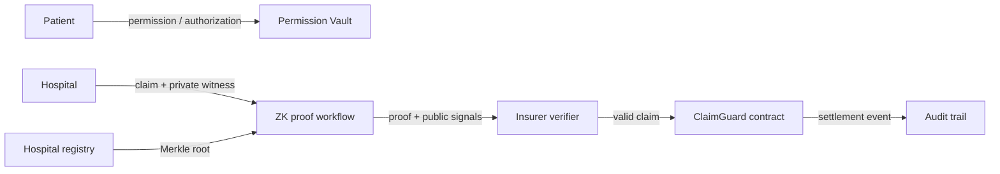

# ZKure

**Verify the claim. Protect the patient.**

ZKure is a privacy-focused healthcare claim verification prototype exploring how zero-knowledge proofs, Merkle membership and smart contracts can reduce unnecessary disclosure during insurance claim review.

> **Prototype status:** This repository contains an early prototype. Some verification, permission and settlement paths are simulated or incomplete. Do not use it with real patient data, real insurance claims, production funds or production infrastructure.


## The problem

Healthcare claim review can require sharing more medical information than a reviewer needs to decide whether a claim satisfies policy conditions. This creates avoidable exposure of sensitive information.

ZKure explores a narrower verification boundary: prove selected eligibility conditions while minimizing disclosure of private medical details.

## The three product pillars

1. **Proof Without Disclosure + Merkle Verification** — a proposed proof flow for approved-hospital membership and claim eligibility conditions.
2. **Patient Permission Vault** — a proposed encrypted-record access workflow with patient-controlled grants, revocation and audit events.
3. **ClaimGuard Settlement** — a proposed smart-contract settlement flow with proof verification and replay protection.

## Architecture at a glance



The diagram describes the intended architecture, not a claim that every integration is currently operational. See [implementation status](docs/IMPLEMENTATION_STATUS.md).

## Repository structure

```text
zkure/
├── backend/       # API prototype and in-memory/demo data handling
├── frontend/      # React + Vite interface
├── contracts/     # Solidity settlement prototype and tests
├── circuits/      # Circom circuit prototype
├── docs/          # Architecture, threat model, status and requirements
├── .github/       # Issue templates and CI workflow
└── README.md
```

## Technology

The current source tree includes:

- React, Vite and JavaScript for the frontend
- Node.js for the backend prototype
- Solidity and Hardhat for the contract prototype
- Circom for the circuit source

The presence of a technology in the repository does not mean its complete production integration has been verified. Check each component's README and implementation-status document.

## Getting started

Requirements: Node.js version compatible with `.nvmrc` and npm.

```bash
# Frontend
cd frontend
npm install
npm run dev
```

```bash
# Backend (in a separate terminal)
cd backend
npm install
cp .env.example .env
npm run dev
```

```bash
# Contracts
cd contracts
npm install
npx hardhat test
```

```bash
# Circuit package
cd circuits
npm install
```

See the component READMEs before attempting proof generation or deployment. Commands and dependencies may need adjustment for your local environment.

## Documentation

- [Architecture](docs/ARCHITECTURE.md)
- [Threat model](docs/THREAT_MODEL.md)
- [Implementation status](docs/IMPLEMENTATION_STATUS.md)
- [Requirements traceability](docs/REQUIREMENTS_TRACEABILITY.md)
- [API reference](docs/API_REFERENCE.md)
- [Demo script](docs/DEMO_SCRIPT.md)
- [Security policy](SECURITY.md)
- [Contributing](CONTRIBUTING.md)

## Security and privacy limitations

- Use synthetic/demo data only. Never upload real patient records.
- The current contract tests use a mock verifier; they do not establish real ZK proof verification.
- Backend verification and settlement behavior may be simulated.
- Permission checks and revocation must be independently audited before any real use.
- A proof can establish encoded statements; it does not establish that a medical record is clinically true or that treatment was necessary.
- Revocation can block future access through the application, but cannot erase copies already downloaded by an authorized recipient.
- Do not deploy with real funds or production keys.

Please report security issues privately as described in [SECURITY.md](SECURITY.md).

## Hackathon context

Prepared as a prototype for Hack-a-Sol 5.0. The official rulebook identifies **Web3 as Track 01**. The exact problem statement identifier and chain requirements must be checked against the team's registered portal entry before final submission. Do not rely on inconsistent track labels in older draft materials.

## AI assistance and credits

AI coding assistance was used during project development. Team members are responsible for reviewing, understanding, testing and disclosing AI-assisted contributions in accordance with event rules.

Third-party libraries and frameworks retain their respective licenses. See package manifests and dependency notices.

## Roadmap

- [ ] Replace simulated verification with a real, tested proof-verification path
- [ ] Finalize patient authorization and claim-context binding
- [ ] Complete replay-resistant nullifier design and tests
- [ ] Integrate a real verifier into the settlement contract
- [ ] Enforce permission grants, expiry and revocation end to end
- [ ] Add integration and end-to-end tests
- [ ] Deploy to the problem-statement-approved public testnet, if required
- [ ] Publish verified contract and demo links

## License

Licensed under the Apache License, Version 2.0. See [LICENSE](LICENSE). Confirm that all contributors have authorized this licensing choice before publishing.
