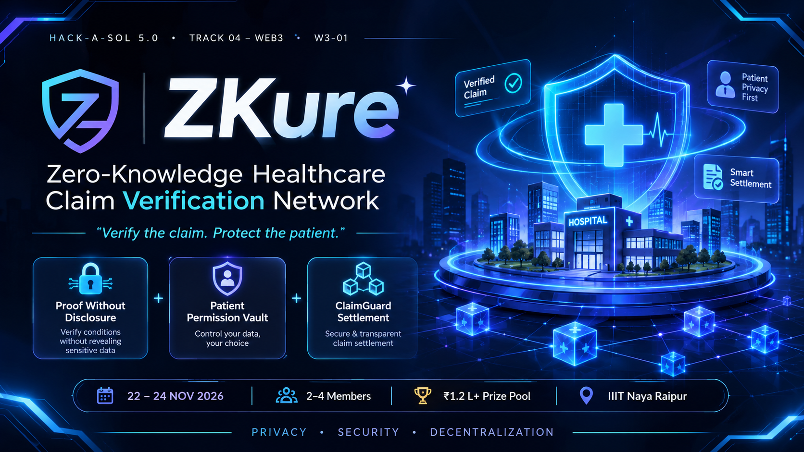
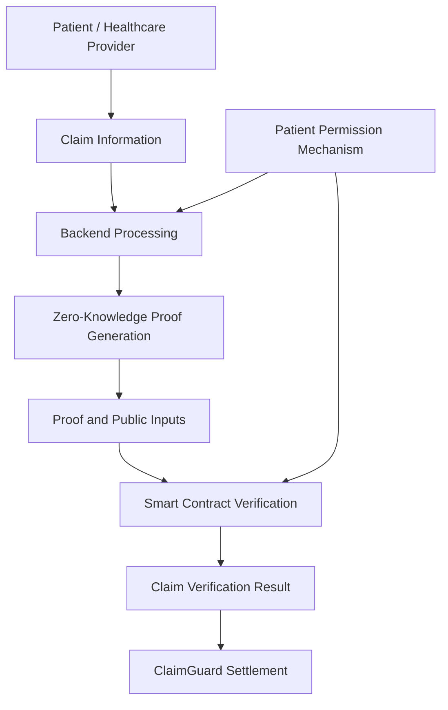

<div align="center">



# ZKure

### Zero-Knowledge Healthcare Claim Verification Network

**Verify the claim. Protect the patient.**

Privacy-preserving healthcare claim verification using Zero-Knowledge Proofs, blockchain and patient-controlled permissions.

[Architecture](docs/ARCHITECTURE.md) · [Implementation Status](docs/IMPLEMENTATION_STATUS.md) · [Security](SECURITY.md) · [Contributing](CONTRIBUTING.md)

</div>

---

<div align="center">


</div>

# 1. Project Overview

Healthcare claim verification often involves sharing sensitive patient information between hospitals, insurers and other parties.

Although insurers need sufficient information to evaluate claims, patients should not have to expose unnecessary medical information to prove eligibility.

**ZKure** explores a privacy-preserving approach to healthcare claim verification using Zero-Knowledge Proofs (ZKPs), blockchain technology and patient permission mechanisms.

The project aims to demonstrate how claim conditions can be verified while minimizing the disclosure of sensitive patient information.

> **Current status:** ZKure is a hackathon prototype. Some components use simulated verification or mock implementations. It is not a production-ready healthcare or insurance system.

---

# 2. The Problem

Traditional healthcare claim workflows can create challenges around privacy, data access and verification.

| Challenge | Description |
|---|---|
| Sensitive data exposure | Medical information may be shared with multiple parties |
| Limited patient control | Patients may have limited visibility into information access |
| Verification complexity | Insurers need evidence that claims satisfy relevant conditions |
| Trust and transparency | Multiple organizations need to coordinate claim decisions |
| Data security | Centralized information systems can create security risks |

The challenge is to verify healthcare claims without unnecessarily exposing the patient's underlying medical information.

---

# 3. Our Solution

ZKure explores a system in which claim eligibility can be verified through privacy-preserving proofs and blockchain-based workflows.

Instead of requiring every participant to access the complete medical record, the proposed approach separates sensitive information from the verification result.

The solution is built around three core pillars:

1. **Proof Without Disclosure:** Explore zero-knowledge proofs for verifying encoded claim conditions.
2. **Patient Permission Vault:** Represent patient-controlled access permissions.
3. **ClaimGuard Settlement:** Explore smart-contract-based claim verification and settlement workflows.

The goal is to combine privacy, verifiability and transparent claim processing.

---

# 4. Our Three Pillars

<div align="center">


</div>

### 01. Proof Without Disclosure + Merkle Verification

Explore verification of hospital membership, policy validity and claim limits without revealing unnecessary confidential medical information.

### 02. Patient Permission Vault

Explore patient-controlled access to selected healthcare records and permission management.

### 03. ClaimGuard Settlement

Explore verifier-gated claim workflows, replay protection and transparent on-chain settlement.

These are the intended feature pillars. Their inclusion in the design does not mean every feature is already fully implemented.

---

# 5. System Architecture

The proposed architecture separates claim information, proof generation and blockchain verification.



### Architecture Components

| Component | Responsibility |
|---|---|
| Patient / Healthcare Provider | Represents participants in the claim workflow |
| Claim Information | Information used to evaluate a claim |
| Backend | Coordinates application-level processing |
| ZK Circuit | Defines conditions intended to be proven |
| Proof and Public Inputs | Represents information submitted for verification |
| Smart Contract | Represents the on-chain verification and settlement layer |
| Permission Mechanism | Represents patient access-control functionality |

For more details, see [Architecture Documentation](docs/ARCHITECTURE.md).

> This diagram represents the intended architecture, not proof of a complete end-to-end implementation.

---

# 6. Technology Stack

ZKure's repository includes the following technologies:

| Technology | Purpose |
|---|---|
| React | Frontend user interface |
| Vite | Frontend development tooling |
| Node.js | Backend runtime |
| Solidity | Smart-contract development |
| Hardhat | Smart-contract development and testing |
| Circom | Zero-knowledge circuit development |
| snarkjs | Zero-knowledge proof tooling |
| ethers.js | Ethereum application interaction |
| EVM-compatible blockchain | Intended smart-contract execution environment |

The exact deployment network and proof-verification configuration should be documented once finalized.

---

# 7. Repository Structure

```text
zkure/
│
├── .github/
│   ├── ISSUE_TEMPLATE/
│   ├── workflows/
│   └── pull_request_template.md
│
├── assets/
│   ├── zkure-tech-stack.png
│   └── zkure-pillars.png
│
├── backend/
│   ├── server.js
│   ├── store.js
│   └── package.json
│
├── circuits/
│   ├── claim_eligibility.circom
│   ├── README.md
│   └── package.json
│
├── contracts/
│   ├── src/
│   │   ├── IMediProofVerifier.sol
│   │   ├── MockMediProofVerifier.sol
│   │   └── MediProofSettlement.sol
│   ├── scripts/
│   ├── test/
│   └── hardhat.config.js
│
├── docs/
│   ├── ARCHITECTURE.md
│   ├── API_REFERENCE.md
│   ├── DEMO_SCRIPT.md
│   ├── IMPLEMENTATION_STATUS.md
│   ├── PROJECT_PROVENANCE.md
│   ├── REQUIREMENTS_TRACEABILITY.md
│   └── THREAT_MODEL.md
│
├── frontend/
│   ├── src/
│   ├── package.json
│   └── ...
│
├── .env.example
├── .gitignore
├── CITATION.cff
├── CODE_OF_CONDUCT.md
├── CONTRIBUTING.md
├── LICENSE
├── README.md
├── SECURITY.md
└── package.json
```

---

# 8. Getting Started

## Prerequisites

Install the following tools:

- Node.js
- npm
- Git
- Visual Studio Code or another code editor

Additional tools may be required for the Circom and Solidity components.

## 1. Clone the repository

```bash
git clone https://github.com/richashuklaa8/zkure.git
cd zkure
```

Replace `YOUR-USERNAME` with the actual GitHub username or organization.

## 2. Install frontend dependencies

```bash
cd frontend
npm install
```

## 3. Install backend dependencies

```bash
cd ../backend
npm install
```

## 4. Install smart-contract dependencies

```bash
cd ../contracts
npm install
```

## 5. Configure environment variables

Review the `.env.example` files and relevant documentation.

Create local environment files only when required.

**Never commit private keys, passwords, access tokens or actual `.env` files.**

## 6. Explore available commands

Inside each component directory, inspect its `package.json` scripts:

```bash
npm run
```

Use the commands documented for that component. Circuit dependencies and setup are described separately in `circuits/README.md`.

---

# 9. Implementation Status

ZKure is an evolving prototype. The following table distinguishes the current prototype from its intended capabilities.

| Component | Current status |
|---|---|
| React frontend | Prototype implementation |
| Node.js backend | Prototype with simulated verification flows |
| Solidity contracts | Implementation includes mock verifier usage |
| Zero-Knowledge circuits | Source code present; further validation required |
| Real proof verification | Complete end-to-end verification not yet demonstrated |
| Patient permissions | Further enforcement and validation required |
| Claim settlement | Prototype workflow; not production settlement |

For detailed information, see:

[Implementation Status](docs/IMPLEMENTATION_STATUS.md)

---

# 10. Security and Limitations

Healthcare information is sensitive. Security and privacy must be treated as core engineering requirements.

### Current limitations

- Simulated backend verification must not be confused with cryptographic proof verification.
- Mock verifier usage does not establish real on-chain proof verification.
- Prototype permission mechanisms must not be treated as production-grade authorization.
- Circuit logic requires further review, testing and security validation.
- Randomly generated identifiers must not be treated as secure cryptographic nullifiers.
- Smart contracts require independent security review before production use.

### Security Principles

- Never commit private keys or credentials.
- Never use real patient medical records in demonstrations.
- Hashing is not encryption.
- A zero-knowledge proof does not independently establish that an underlying medical record is truthful.
- Revoking access cannot erase information that another party has already copied.
- Experimental contracts should not be used with real funds or production healthcare data.

Read the [Security Policy](SECURITY.md) and [Threat Model](docs/THREAT_MODEL.md) for further information.

---

# 11. Development Roadmap

The following items are development goals, not claims of completed functionality.

- [ ] Validate and strengthen zero-knowledge circuit constraints.
- [ ] Implement secure, domain-separated nullifiers.
- [ ] Introduce appropriate patient and healthcare-provider authorization.
- [ ] Integrate real proof generation and verification.
- [ ] Replace mock verifier usage with validated verification.
- [ ] Strengthen permission enforcement and revocation.
- [ ] Improve smart-contract access controls.
- [ ] Add comprehensive automated tests.
- [ ] Validate the complete claim verification workflow.
- [ ] Evaluate deployment on the required public test network.
- [ ] Conduct security and privacy reviews.

---

# 12. Contributing

Contributions, suggestions and technical discussions are welcome.

Before contributing:

1. Read [CONTRIBUTING.md](CONTRIBUTING.md).
2. Review the existing implementation.
3. Open an issue to discuss substantial changes.
4. Submit changes through a pull request.
5. Include relevant tests and documentation.

Please follow the project's [Code of Conduct](CODE_OF_CONDUCT.md).

---

# 13. AI Disclosure and Acknowledgements

AI-assisted development tools may be used during the development process for:

- Research and brainstorming
- Documentation preparation
- Code assistance
- Debugging support
- Development guidance

AI-assisted contributions must be reviewed, understood, tested and validated by the project contributors.

The team remains responsible for understanding the submitted implementation and disclosing AI assistance in accordance with the applicable hackathon rules.

---

*Project concept poster. Confirm event details and the official track label before publishing this graphic.*

---

## License

This repository includes a `LICENSE` file. Refer to that file for the applicable licence terms.

Copyright attribution and licence arrangements should be confirmed by the relevant contributors before public distribution.

---

<div align="center">

# ZKure

### Verify the claim. Protect the patient.

**Privacy. Security. Decentralized Trust.**

Building toward a more privacy-conscious approach to healthcare claim verification.

</div>
