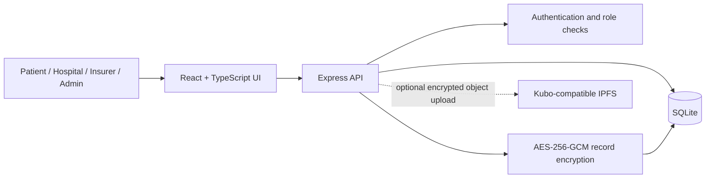
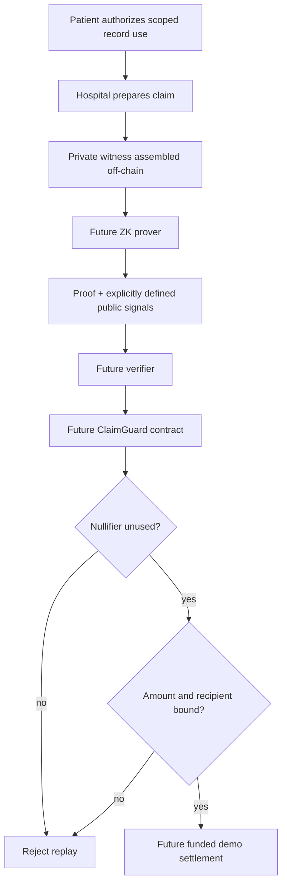

# Architecture

## Current system

The diagram describes the existing prototype boundary. It does not imply a deployed chain or a proof system.

## Intended privacy-preserving claim path

Everything labelled future is a design target, not an implemented capability.

## Trust boundaries

- Browser: patient-controlled interaction and any future client-side secret material.
- API: authentication, authorization, encrypted record operations, and application workflow orchestration.
- Database/object storage: ciphertext and required cryptographic metadata.
- Future proof system: circuit constraints and proof generation/verification.
- Future chain: public commitments, registry root, nullifiers, verifier result, and settlement events only.

Do not place diagnoses, prescriptions, raw medical records, encryption keys, or private witnesses on-chain.
